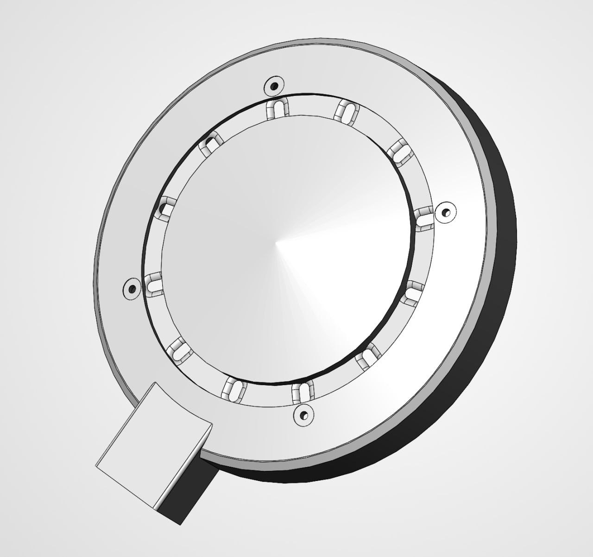
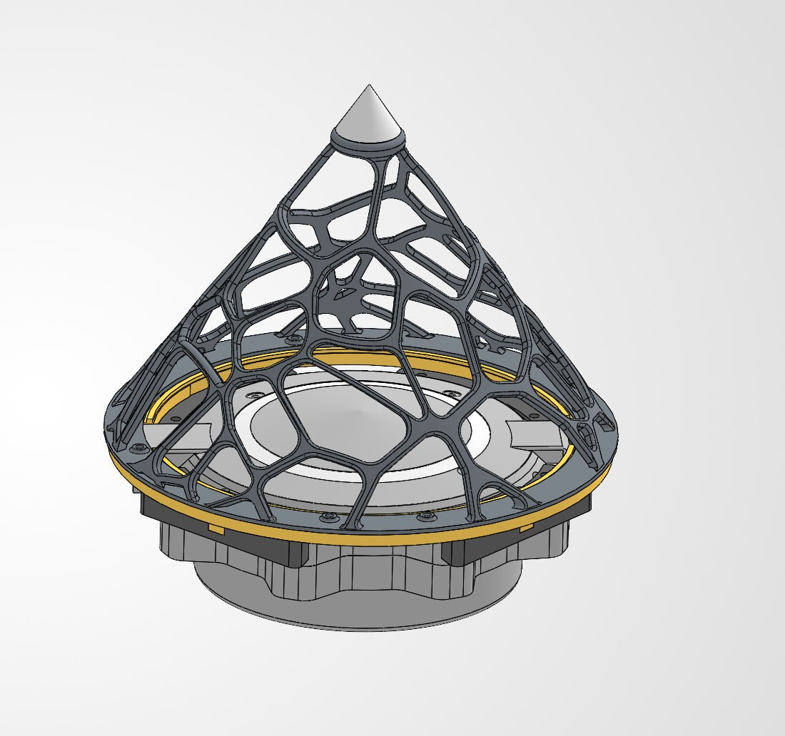

# Корпус DIY v0.1.0-wip · DIY enclosure

**[Русский](#русский)** · **[English](#english)**

STL для печати узла NEVOD DIY (XIAO ESP32-S3 + XVF3800): корпус и ветрозащита — два релиза.  
Смета: [BOM.md](BOM.md). Полная инструкция: [DIY_GUIDE.md](DIY_GUIDE.md). Лицензия: [MIT](../LICENSE).

| Корпус | Ветрозащита |
|--------|-------------|
| [](https://github.com/Gfermoto/UAV-radar/releases/tag/nevod-diy-enclosure-v0.1.1) | [](https://github.com/Gfermoto/UAV-radar/releases/tag/nevod-diy-windscreen-v0.1.0) |
| **[Релиз STL v0.1.1](https://github.com/Gfermoto/UAV-radar/releases/tag/nevod-diy-enclosure-v0.1.1)** — body **0.1.3** + lid **monoblock 0.1.2** и базовые body/lid **0.1.0**. Предыдущий: [v0.1.0](https://github.com/Gfermoto/UAV-radar/releases/tag/nevod-diy-enclosure-v0.1.0). Файлы: [`enclosure/diy/v0.1.0-wip/stl/`](../enclosure/diy/v0.1.0-wip/stl/). | **[Релиз STL v0.1.0](https://github.com/Gfermoto/UAV-radar/releases/tag/nevod-diy-windscreen-v0.1.0)** — рамка Вороного, кольцо адаптера, секция (4 шт.), крышка. Файлы: [`enclosure/diy/windscreen/stl/`](../enclosure/diy/windscreen/stl/). |

Печатный drop корпуса — не финальный профиль: без Bambu `.3mf`. Метизы: [BOM.md](BOM.md) (O-ring 5/6 мм, M2 / M3×19).

---

<a id="русский"></a>
## Русский

### Что печатать (лето, рекомендуется)

| Файл | Деталь | Зачем | Материал |
|------|--------|--------|----------|
| `nevod-diy-body-v0.1.3.stl` | низ (bot) | лучше держит **летнюю ветрозащиту** (салфетки робота-мойщика) | ASA (смета) или PETG |
| `nevod-diy-lid-monoblock-v0.1.2.stl` | верх монолитный | одна деталь: проще **сборка и герметизация**; DoA через AMS (ниже) | ASA или PETG |
| `nevod-diy-gasket-v0.1.0.stl` | прокладка | без изменений | **TPU** (альтернатива: резиновая прокладка / O‑ring того же размера; перед сборкой — силиконовая смазка) |
| `nevod-diy-led-ring-v0.1.0.stl` | кольцо LED | без изменений | прозрачный / матовый просвечивающийся ASA или PETG (**тот же состав**, что body/lid) |

### Базовый набор v0.1.0 (остаётся в дереве)

| Файл | Деталь | Примечание |
|------|--------|------------|
| `nevod-diy-body-v0.1.0.stl` | низ | предыдущий bot; для лета предпочтительнее **0.1.3** |
| `nevod-diy-lid-v0.1.0.stl` | крышка | предыдущий top; для сборки/герметизации предпочтительнее **monoblock 0.1.2** |

### Ветрозащита

Релиз **[nevod-diy-windscreen-v0.1.0](https://github.com/Gfermoto/UAV-radar/releases/tag/nevod-diy-windscreen-v0.1.0)**. Секция адаптера в файле одна — печатать **4 штуки**.

| Файл | Деталь |
|------|--------|
| `nevod-diy-windscreen-voronoi-frame-v0.1.0.stl` | рамка Вороного |
| `nevod-diy-windscreen-adapter-ring-v0.1.0.stl` | кольцо адаптера |
| `nevod-diy-windscreen-adapter-section-v0.1.0.stl` | секция адаптера (×4) |
| `nevod-diy-windscreen-cap-v0.1.0.stl` | крышка рамки |

### Lid monoblock 0.1.2 — сборка и DoA

Верх — **единая деталь**: меньше стыков, проще собрать и герметизировать.

Визуальный эффект DoA на принтере с **AMS**: при высоте слоя **0.2 мм** смените пруток на **прозрачный** на **91-м слое** и верните основной цвет на **105-м**. Окно в корпусе получается без отдельной вставки.

Слой 0.2 мм — разумный старт. Infill / supports — по слайсеру.

### Постобработка (ASA / PETG)

1. Впаять закладные втулки **до** химии.  
2. Изнутри прокапать отверстия под LED, затем сгладить **снаружи** паром: **ASA** — ацетон; **PETG** — пар ТГФ, прокапывание LED‑отверстий изнутри **хлористым метиленом**.  
3. Отлёжка **≥ 24 ч**, потом сборка. TPU / резиновый уплотнитель растворителями не обрабатывать; **перед сборкой** смазать **силиконовой смазкой**.  
Вытяжка / перчатки; пары токсичны.

Полная сборка (с фото): [DIY_GUIDE.md](DIY_GUIDE.md) §7. Метизы: [BOM](BOM.md).

### SHA-256

```
671f0a112852af0fb3eb8720b0403683e8d2e520df3119085891fbfe2a8e7ea1  nevod-diy-body-v0.1.0.stl
60dfd7a9c8c71554b7ef7b84d1fddfe892872635a9e8deb1225968a946cad842  nevod-diy-body-v0.1.3.stl
11b0b0e0d9d5843eb146686fcda5b3b8654ab0def9992a3ef6737d5385d3d30b  nevod-diy-lid-v0.1.0.stl
a417355b503290862332c54ed29ef5c7db83a7f3578baf392f3511f4689ad451  nevod-diy-lid-monoblock-v0.1.2.stl
efb9811aa72d92917db2e4675d3f1c93c0f4480cf7b29eb6c0801c0f765672bf  nevod-diy-gasket-v0.1.0.stl
4f9c97608a14d9871e6fac4c1d3b043041f57cd2ad26a419bc2e2810024499e4  nevod-diy-led-ring-v0.1.0.stl
29aa922ddcc3f49e68875dc725e2f0b4cbc4024ae7952e0e03092f22a9b7b12b  nevod-diy-windscreen-adapter-ring-v0.1.0.stl
772bd69f70a035e50e6773e1de39c932a7321c798c2b19dbd09744e3221a48ef  nevod-diy-windscreen-adapter-section-v0.1.0.stl
389b42868ef5f6c5cbe0a6d776a2ab3adb6d2345e79db9c87ec52d2038844274  nevod-diy-windscreen-cap-v0.1.0.stl
b803946d45b9de76c56b0ea3d803406a705ff1ec17509241ed75a1ae1b8248a1  nevod-diy-windscreen-voronoi-frame-v0.1.0.stl
```

---

<a id="english"></a>
## English

### What to print (summer, recommended)

| File | Part | Why | Material hint |
|------|------|-----|----------------|
| `nevod-diy-body-v0.1.3.stl` | body (bottom) | better hold for the **summer wind screen** (robot window-washer wipes) | ASA (BOM) or PETG |
| `nevod-diy-lid-monoblock-v0.1.2.stl` | monolithic lid | one piece: easier **assembly and sealing**; DoA via AMS (below) | ASA or PETG |
| `nevod-diy-gasket-v0.1.0.stl` | gasket | unchanged | **TPU** (or rubber gasket / O‑ring of matching size; **silicone grease** before assembly) |
| `nevod-diy-led-ring-v0.1.0.stl` | LED ring | unchanged | clear / matte translucent ASA or PETG (**same polymer** as body/lid) |

### Baseline v0.1.0 (kept in tree)

| File | Part | Note |
|------|------|------|
| `nevod-diy-body-v0.1.0.stl` | body | previous bot; prefer **0.1.3** for summer |
| `nevod-diy-lid-v0.1.0.stl` | lid | previous top; prefer **monoblock 0.1.2** for assembly/seal |

### Wind screen

Release **[nevod-diy-windscreen-v0.1.0](https://github.com/Gfermoto/UAV-radar/releases/tag/nevod-diy-windscreen-v0.1.0)**. The adapter section file is one part — print **four**.

| File | Part |
|------|------|
| `nevod-diy-windscreen-voronoi-frame-v0.1.0.stl` | Voronoi frame |
| `nevod-diy-windscreen-adapter-ring-v0.1.0.stl` | adapter ring |
| `nevod-diy-windscreen-adapter-section-v0.1.0.stl` | adapter section (×4) |
| `nevod-diy-windscreen-cap-v0.1.0.stl` | frame cap |

### Lid monoblock 0.1.2 — assembly and DoA

The top is a **single part**: fewer joints, easier to assemble and seal.

DoA window trick on a printer with **AMS**: at **0.2 mm** layer height, switch to **clear** filament at layer **91**, switch back to the main color at layer **105**. No separate insert.

Layer 0.2 mm is a reasonable start. Infill / supports: your slicer.

Enclosure release **v0.1.1** ships the summer kit plus baseline body/lid **0.1.0**. Previous: [v0.1.0](https://github.com/Gfermoto/UAV-radar/releases/tag/nevod-diy-enclosure-v0.1.0). Printed wind screen: [v0.1.0](https://github.com/Gfermoto/UAV-radar/releases/tag/nevod-diy-windscreen-v0.1.0).

### Post-processing (ASA / PETG)

1. Heat-set inserts **before** chemistry.  
2. Pre-drip LED holes from the inside, then vapor-smooth **outside**: **ASA** — acetone; **PETG** — THF vapor, LED holes dripped with **methylene chloride**.  
3. Rest **≥ 24 h**, then assemble. Do not solvent-treat TPU / rubber seals; coat with **silicone grease** before assembly. Ventilate; fumes are hazardous.

Full assembly (with photos): [DIY_GUIDE.md](DIY_GUIDE.md) §7. Fasteners: [BOM](BOM.md).

### SHA-256

```
671f0a112852af0fb3eb8720b0403683e8d2e520df3119085891fbfe2a8e7ea1  nevod-diy-body-v0.1.0.stl
60dfd7a9c8c71554b7ef7b84d1fddfe892872635a9e8deb1225968a946cad842  nevod-diy-body-v0.1.3.stl
11b0b0e0d9d5843eb146686fcda5b3b8654ab0def9992a3ef6737d5385d3d30b  nevod-diy-lid-v0.1.0.stl
a417355b503290862332c54ed29ef5c7db83a7f3578baf392f3511f4689ad451  nevod-diy-lid-monoblock-v0.1.2.stl
efb9811aa72d92917db2e4675d3f1c93c0f4480cf7b29eb6c0801c0f765672bf  nevod-diy-gasket-v0.1.0.stl
4f9c97608a14d9871e6fac4c1d3b043041f57cd2ad26a419bc2e2810024499e4  nevod-diy-led-ring-v0.1.0.stl
29aa922ddcc3f49e68875dc725e2f0b4cbc4024ae7952e0e03092f22a9b7b12b  nevod-diy-windscreen-adapter-ring-v0.1.0.stl
772bd69f70a035e50e6773e1de39c932a7321c798c2b19dbd09744e3221a48ef  nevod-diy-windscreen-adapter-section-v0.1.0.stl
389b42868ef5f6c5cbe0a6d776a2ab3adb6d2345e79db9c87ec52d2038844274  nevod-diy-windscreen-cap-v0.1.0.stl
b803946d45b9de76c56b0ea3d803406a705ff1ec17509241ed75a1ae1b8248a1  nevod-diy-windscreen-voronoi-frame-v0.1.0.stl
```
